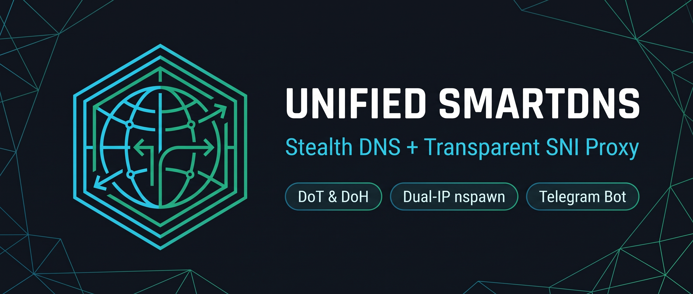
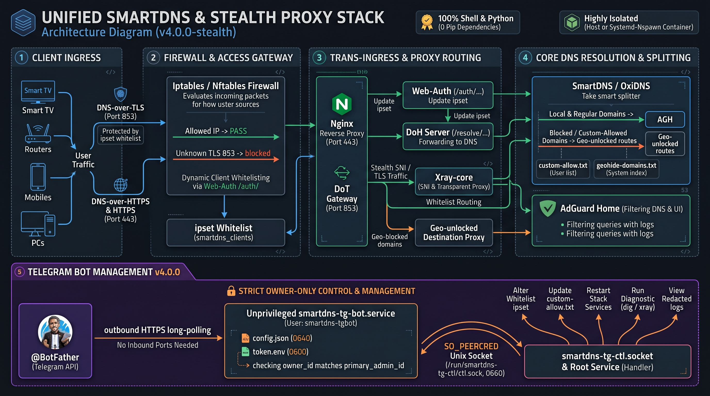
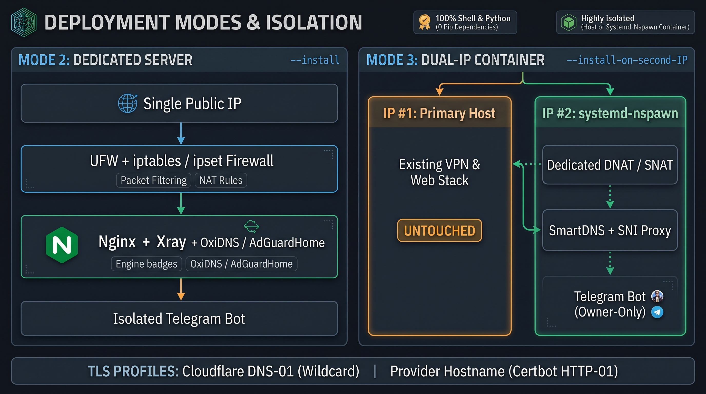
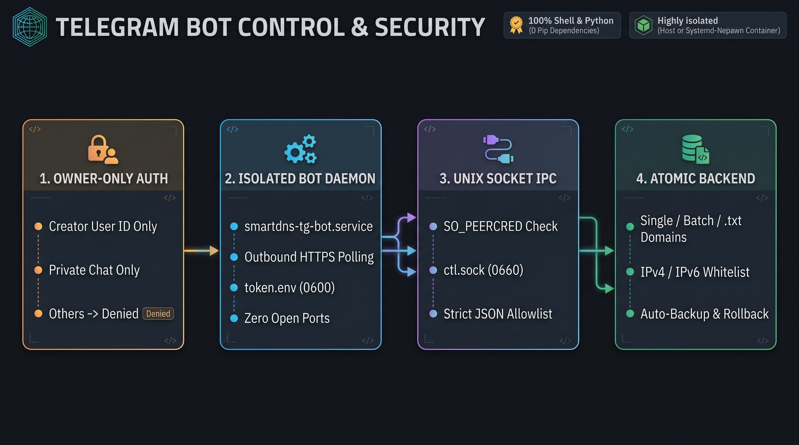

<p align="center">
  
</p>

# Unified SmartDNS + Transparent SNI Proxy Installer

[](https://pay.cloudtips.ru/p/9785e813)

**Язык / Language:** **Русский** | [English](README_EN.md)

[](https://github.com/EvgenyElizarenko/smartdns-installer/releases/latest)
[](#4-технические-требования)
[](#51-выбор-языка-интерфейса-русский--english)
[](https://github.com/EvgenyElizarenko/smartdns-installer/actions)

Единый транзакционный Bash-установщик для развёртывания отказоустойчивого стека **SmartDNS (DoH + DoT) + Transparent SNI Proxy (Xray-core) + Stealth Cover Site (Nginx)** на собственном VPS с автоматическим выпуском wildcard TLS-сертификатов через Cloudflare DNS-01 и динамической авторизацией клиентских IP-адресов.

> [!IMPORTANT]
> Скрипт не предназначен для обхода блокировок со стороны РКН и доступа к ресурсам заблокированным на территории РФ! Данный скрипт позволяет получить доступ к зарубежным ИИ сервисам, заблокированным для пользователей из стран, где они недоступны.

---

## Что нового в v4.0.0-stealth

- **Постоянное имя файла установщика (`smartdns-installer.sh`):** начиная с `v4.0.0-stealth` скрипт в репозитории и в GitHub Releases (`Latest`) всегда называется `smartdns-installer.sh`; версия фиксируется внутри скрипта (`INSTALLER_VERSION="4.0.0-stealth"`), в тегах и релизах GitHub.
- **Опциональный Telegram-бот управления SmartDNS (`[19]` / `--install-telegram-bot`):**
  - **двухслойная изоляция без `pip`-зависимостей (Python 3 stdlib):** непривилегированный демон `smartdns-tg-bot.service` (`User=smartdns-tgbot`, исходящий HTTPS long polling, **0 входящих портов**) взаимодействует с короткоживущим root-backend `smartdns-tg-ctl.socket` строго через локальный Unix-сокет `/run/smartdns-tg-ctl/ctl.sock` (`0660`, проверка `SO_PEERCRED`, allowlist типизированных JSON-команд, без `eval` и `shell=True`);
  - **строгий доступ `Owner-Only`:** управление разрешено исключительно создателю бота (`primary_admin_id`) в приватном чате на обоих слоях (`bot.py` + `ctl.py`); любые сторонние пользователи получают отказ в авторизации;
  - **управление доменами (3 способа в едином конвейере):** одиночный домен, массовый текстовый список (перенос строки, `,`, `;`, комментарии `#`) и загрузка `.txt`-файлов (проверка UTF-8/BOM, размера, защита от бинарных/архивов, очистка временных файлов) с отчётом, пагинацией, подтверждением и транзакционным откатом при ошибке;
  - **дополнительные инструменты управления:** поиск, удаление/массовое удаление пользовательских доменов (`custom-allow.txt`), экспорт/бэкап, история, проверка DNS и маршрутизации Xray; просмотр, добавление, массовое добавление, удаление, поиск и экспорт IPv4/IPv6 в `ipset` whitelist; актуальные ссылки DoT/DoH/Web-Auth; статус служб, CPU/RAM/диска и срока TLS-сертификата; перезапуск служб по allowlist, просмотр логов со скраббингом секретов, диагностика, управление модулями и `audit.log`;
  - **независимый жизненный цикл и поддержка контейнера:** 8 команд `--telegram-bot-*` работают как на выделенном хосте, так и в контейнере `systemd-nspawn` (`--target container`); `--telegram-bot-remove` удаляет только бота без затрагивания SmartDNS.
- **Полная совместимость с `v3.1.0-stealth`:** сохранены оба режима установки (выделенный сервер и `systemd-nspawn` на 2-м IP), `Initial Server Setup`, `Provider Hostname Profile` ([HOSTNAME_SETUP.md](HOSTNAME_SETUP.md)), синхронизация дизайна `/auth/` и автопродление Cloudflare `v3.0`.

## Содержание

1. [Назначение и ключевые возможности](#1-назначение-и-ключевые-возможности)
2. [Архитектура и стелс-маскировка](#2-архитектура-и-стелс-маскировка)
3. [Сравнение поддерживаемых DNS-движков](#3-сравнение-поддерживаемых-dns-движков)
4. [Технические требования](#4-технические-требования)
5. [Установка и первоначальная настройка](#5-установка-и-первоначальная-настройка)
   * [5.1. Выбор языка интерфейса](#51-выбор-языка-интерфейса-русский--english)
   * [5.2. Загрузка и запуск интерактивного меню](#52-загрузка-и-запуск-интерактивного-меню)
   * [5.3. Первоначальная настройка сервера и усиление безопасности SSH](#53-первоначальная-настройка-сервера-и-усиление-безопасности-ssh)
   * [5.4. Изолированная установка на сервер с 2мя IP (`systemd-nspawn`)](#54-изолированная-установка-на-сервер-с-2мя-ip-systemd-nspawn)
   * [5.5. Установка и настройка Telegram-бота (опционально)](#55-установка-и-настройка-telegram-бота-опционально)
6. [Справочник команд CLI](#6-справочник-команд-cli)
7. [Настройка клиентских устройств](#7-настройка-клиентских-устройств)
8. [Безопасность, резервное копирование и диагностика](#8-безопасность-резервное-копирование-и-диагностика)
9. [Устранение неполадок (Troubleshooting)](#9-устранение-неполадок-troubleshooting)

---

## 1. Назначение и ключевые возможности

Скрипт автоматизирует полное развёртывание и обслуживание персонального SmartDNS-сервера:

* **Двуязычный интерфейс командной строки (`RU / EN`):** интерактивный выбор русского (по умолчанию) или английского языка при каждом запуске, а также корректная работа в неинтерактивном режиме (`cron`, `systemd`, `EOF`).
* **Транзакционная модель установки с автооткатом:** перед любыми изменениями создаётся полный снимок конфигураций и правил сетевого экрана; при сбое любого шага (`ERR`-ловушка) система автоматически восстанавливается в исходное состояние.
* **Горячее переключение DNS-движков:** поддержка **OxiDNS** (Rust) и **AdGuardHome** (Go) с возможностью переключения на работающем сервере командой `--switch-engine` без перевыпуска сертификатов и смены клиентских ссылок.
* **Единый TLS SNI-профиль на порту `443/TCP`:** на одном домене второго уровня (`ROOT_DOMAIN`) одновременно работают сайт-заглушка (Cover Site), секретный эндпоинт DNS-over-HTTPS (`/resolve/<SECRET>`), веб-портал авторизации IP (`/auth/<SECRET>`) и прозрачный SNI-прокси для целевых сервисов.
* **Сохранение реального IP-адреса клиента (`PROXY protocol v1`):** Xray-core передаёт исходный IP клиента в Nginx, исключая подмену адреса на `127.0.0.1` в журналах доступа.
* **Динамическая авторизация по `ipset` с TTL 24 часа:** доступ к SNI-прокси и (опционально) к порту DoT `853/TCP` открывается только для IP-адресов, прошедших авторизацию через секретный DoH, секретный DoT SNI или веб-портал `/auth/`.
* **Контроль целостности и минимальные привилегии:** проверка контрольных сумм SHA-256 загружаемых бинарных релизов и запуск всех рабочих служб (`xray`, `oxidns`, `adguardhome`, `nginx`) от непривилегированных системных пользователей.
* **Встроенный комплекс самодиагностики (`--test`):** 25 функциональных и негативных автотестов для проверки DNS-подмен, `NODATA` для `AAAA`/`HTTPS (TYPE65)`, маскировки путей HTTP 404, правил firewall и изоляции внутренних портов.

---

## 2. Архитектура и стелс-маскировка

<p align="center">
  
</p>

### Схема обработки трафика

```text
Клиент (DoH / DoT / HTTPS)
  │
  ├──► TCP 443 (Внешний интерфейс)
  │      │
  │      ▼
  │    Xray-core (unprivileged user, TLS SNI Sniffing, порт 8444/TCP через PREROUTING)
  │      ├── SNI = ROOT_DOMAIN ──► Nginx (127.0.0.1:9444, PROXY protocol v1)
  │      │                           ├── /resolve/<DOH_PATH> ──► DoH (127.0.0.1:8053) + автодобавление IP в ipset
  │      │                           ├── /auth/<DOH_PATH>    ──► Веб-авторизация IP клиента в ipset (TTL 86400s)
  │      │                           └── / (и любые иные пути) ──► Уникальный процедурный Cover Site (HTTP 200 / 404)
  │      │
  │      └── SNI ∈ Целевые домены (и IP ∈ ipset smartdns_clients)
  │            └──► Прозрачное TLS-проксирование к целевому серверу (без расшифровки трафика)
  │
  └──► TCP 853 (Внешний интерфейс, опциональная фильтрация ipset)
         │
         ▼
       Xray-core (DoT SNI Router, порт 8853/TCP)
         ├── SNI = DOT_HOST ──► Локальный DoT-апстрим + автодобавление IP в ipset
         └── Любой иной SNI ──► Разрыв соединения (blackhole) без выдачи сертификата
```

### Ключевые механизмы защиты от обнаружения
1. **Процедурный уникальный Cover Site:** при установке генерируется индивидуальный многосекционный статический сайт (HTML5 + CSS3) с случайной тематикой, брендом, цветовой палитрой и структурой без технических маркеров и без упоминания IP-адреса сервера в разметке. При выполнении `--update` существующий сайт сохраняется; перегенерация выполняется только по явному запросу `--regenerate-cover`.
2. **Маскировка секретных маршрутов:** любые запросы к эндпоинтам `/resolve/*` и `/auth/*` без точного 48+ символьного секретного пути возвращают стандартный ответ веб-сервера `HTTP 404`.
3. **Подавление утечек IPv6 и SVCB:** для проксируемых доменов DNS-движок отдаёт `NOERROR/NODATA` на запросы `AAAA` и `HTTPS/SVCB (TYPE65)`, предотвращая попытки браузера обойти IPv4-прокси по IPv6 или QUIC/HTTP3.

---

## 3. Сравнение поддерживаемых DNS-движков

| Характеристика | 1) OxiDNS (Rust) | 2) AdGuardHome (Go) |
| :--- | :--- | :--- |
| **Потребление RAM** | Минимальное (~15–30 МБ) | Умеренное (~60–120 МБ) |
| **Архитектура конвейера** | Нативная обработка списков `geosite.dat` и YAML-правил | Правила перезаписи `$dnsrewrite` и списки фильтрации |
| **Поддержка NODATA (`AAAA` / `TYPE65`)** | Нативная через `hosts` / `reject` | Через правила `$dnsrewrite=NOERROR` |
| **Локальный веб-интерфейс статистики** | Отсутствует (управление через конфиг и CLI) | Есть (`http://127.0.0.1:8053`, доступ только через SSH-туннель) |
| **Поддерживаемые архитектуры CPU** | Только `x86_64` (`amd64`) | `x86_64` (`amd64`) и `aarch64` (`arm64`) |

---

## 4. Технические требования

### 4.1. Серверная часть (ОС, ядро и ресурсы)
| Компонент | Минимальные требования | Рекомендуемые / примечания |
| :--- | :--- | :--- |
| **Операционная система** | Debian 12 (Bookworm), Debian 13 (Trixie), Ubuntu 22.04 LTS, Ubuntu 24.04 LTS | Чистая минимальная установка ОС без предустановленных панелей управления |
| **Архитектура CPU** | `x86_64` (`amd64`) или `aarch64` (`arm64`) | `OxiDNS` поддерживает только `x86_64`; `AdGuardHome` работает на `x86_64` и `aarch64` |
| **Оперативная память (RAM)** | **512 МБ** | От **1 ГБ** (проверяется автоматически на этапе `--preflight`) |
| **Дисковое пространство** | **1.5 ГБ** свободного места | Для бинарных файлов, баз `geosite.dat`, журналов и транзакционных бэкапов |
| **Ядро Linux и модули** | Linux Kernel 5.10+, `systemd` | Обязательна поддержка `netfilter` (`iptables`/`ip6tables`) и модулей `ipset` (`hash:ip` с поддержкой `timeout`) |
| **Права доступа** | Доступ `root` (`sudo`) для запуска скрипта | Все рабочие службы (`xray`, `oxidns`, `adguardhome`, `nginx`) запускаются от непривилегированных пользователей |

### 4.2. Сеть, порты и программное окружение
* **Публичный IP-адрес:** выделенный статический публичный **IPv4-адрес** на основном сетевом интерфейсе (работа за NAT провайдера / CG-NAT не поддерживается). Наличие глобального **IPv6** опционально — при его наличии правила `ip6tables` и `ipset` настраиваются автоматически.
* **Входящие порты (должны быть открыты в панели хостинг-провайдера):**
  * `22/TCP` (или ваш нестандартный порт SSH) — для администрирования;
  * `80/TCP` — HTTP-редирект и базовые проверки;
  * `443/TCP` — HTTPS Cover Site, эндпоинт DoH (`/resolve/...`), портал авторизации (`/auth/...`) и прозрачный SNI-прокси;
  * `853/TCP` — DNS-over-TLS (DoT).
* **Исходящие соединения с сервера:** свободный доступ по `443/TCP` и `53/UDP+TCP` к API Cloudflare, серверам Let's Encrypt, GitHub Releases (для загрузки бинарных файлов и списков `GeoHideDNS`/`geosite.dat`) и апстримам DoH (`1.1.1.1`, `8.8.8.8`).
* **Отсутствие конфликтующего ПО:** на сервере не должны быть запущены другие веб-серверы (`apache2`, `caddy`, сторонний `nginx`), локальные DNS-резолверы или прокси-панели, занимающие порты `80`, `443`, `853`, `5353`, `8053`, `8443`, `8444`, `8853`, `9443`, `9444`. При наличии **Docker** установщик автоматически размещает цепочки `SMARTDNS_PREROUTING` выше правил контейнеров.

### 4.3. Домен, DNS-провайдер и клиентская сторона
* **Домен и Cloudflare:**
  * Собственный домен второго уровня (`ROOT_DOMAIN`), делегированный на NS-серверы **Cloudflare**.
  * API-токен Cloudflare с правом **`Zone — DNS — Edit`** для целевой зоны.
  * Все записи (`@`, `*`, поддомен DoT) должны работать строго в режиме **DNS Only (серое облако)** — включение проксирования Cloudflare (оранжевое облако) нарушит работу SNI-прокси и DoT.
* **Клиентские устройства:**
  * Поддержка протоколов **DNS-over-HTTPS (RFC 8484)** или **DNS-over-TLS (RFC 7858)** на уровне ОС, браузера или роутера.
  * Поддержка **TLS 1.2 / 1.3** с передачей расширения **SNI (Server Name Indication)** в открытом виде (без ECH/ESNI для целевых доменов).
  * Отключённый резервный DNS интернет-провайдера (`peerdns = 0` на роутерах), чтобы избежать утечки DNS-запросов мимо SmartDNS.

---

## 5. Установка и первоначальная настройка

<p align="center">
  
</p>

### 5.1. Выбор языка интерфейса (Русский / English)

При каждом интерактивном запуске скрипт перед началом выполнения любых операций запрашивает язык пользовательского интерфейса:

```text
Выберите язык интерфейса / Select interface language:

1) Русский (по умолчанию)
2) English

Ваш выбор / Your choice [1]:
```

* **`1` или `Enter`** — включает русский интерфейс (значение по умолчанию).
* **`2`** — переключает все меню, подсказки, диагностические сообщения, отчёты и вывод автотестов `--test` на английский язык.
* **Неинтерактивный запуск (`cron`, `systemd`, перенаправление из `/dev/null` / `EOF`):** при отсутствии интерактивного терминала или закрытии потока ввода скрипт не блокирует выполнение и автоматически использует русский язык (либо язык, явно переданный через переменную окружения `SCRIPT_LANG=en` или `SCRIPT_LANG=ru`).

### 5.2. Загрузка и запуск интерактивного меню

Все операции — первоначальная настройка сервера, предварительная диагностика, установка на выделенный сервер или на 2-й IP, запуск автотестов, переключение DNS-движка, управление группами доменов и DoT whitelist, обновление, резервное копирование, откат и удаление — интегрированы в **единое интерактивное меню `[0–19]`**. Запоминать отдельные флаги CLI для повседневной работы не требуется.

1. **Скачайте скрипт, проверьте контрольную сумму `SHA-256` и выдайте права на выполнение:**
   ```bash
   curl -fsSL "https://raw.githubusercontent.com/EvgenyElizarenko/smartdns-installer/refs/heads/main/smartdns-installer.sh" -o smartdns-installer.sh
   echo "9f9e36f45584bfcbd52db76885a59100095001c5a4d6e5b06b0b5b6829862d6a  smartdns-installer.sh" | sha256sum -c -
   chmod +x smartdns-installer.sh
   ```

2. **Запустите единое интерактивное меню:**
   ```bash
   sudo ./smartdns-installer.sh
   ```

3. **Типовой порядок установки на выделенный сервер через меню:**
   * **Предварительная проверка (read-only):** выберите пункт предварительной диагностики (`[6]` / `--preflight`), чтобы проверить ОС, ядро, ресурсы, порты и совместимость движков без изменения системы.
   * **Начальная настройка и защита SSH (рекомендуется для нового VPS):** выберите пункт **`[1]`** (подробнее см. раздел [5.3](#53-первоначальная-настройка-сервера-и-усиление-безопасности-ssh)).
   * **Установка стека на выделенный сервер:** выберите пункт **`[2]`** (`--install`). Интерактивный мастер последовательно запросит:
     * профиль установки (`1` — Cloudflare DNS-01 с wildcard-сертификатом, `2` — Provider Hostname Profile без Cloudflare, см. [HOSTNAME_SETUP.md](HOSTNAME_SETUP.md));
     * DNS-движок (`1` — OxiDNS, `2` — AdGuardHome);
     * основной домен второго уровня (`ROOT_DOMAIN`, например `example.com`) и поддомен DoT (`DOT_HOST`, по умолчанию генерируется случайный 10-символьный префикс);
     * генерацию или ввод 48-символьного секретного пути `DOH_PATH`;
     * включение и режим `ipset`-фильтрации для DoT (`shared` или `separate`), группы доменов и дополнительные фильтры (`EXCLUDE_GOOGLE_SYS`, `INCLUDE_XBOX_IPIFY`);
     * API-токен Cloudflare (`Zone:DNS:Edit`) и контактный email для сертификатов Let's Encrypt (для профиля Cloudflare).
   * **Проверка работы стека:** после завершения установки выберите пункт автотестов (`[9]` / `--test`), чтобы прогнать все 26 функциональных и негативных проверок.

> **Автоматизация:** все пункты меню по-прежнему доступны напрямую через флаги командной строки из раздела [6. Справочник команд CLI](#6-справочник-команд-cli) (для `cron`, `systemd` и скриптов развёртывания).

### 5.3. Первоначальная настройка сервера и усиление безопасности SSH

Этап **Initial Server Setup & Security Hardening** запускается из интерактивного меню (пункт **`[1]`** или флаг `--initial-setup`), а также автоматически предлагается перед установкой на выделенный сервер (`[2]`), если ещё не выполнялся.

* **Состав и порядок работы:** включает **10 настраиваемых шагов** и финальный **16-пунктовый аудит безопасности**. При выборе полного прохода **`[A]`** шаги выполняются в безопасном порядке: базовая подготовка системы и создание администратора с `sudo` → установка и проверка SSH-ключей (**шаг 7**) → смена порта SSH (**шаг 6**) → отключение входа по паролю (**шаг 8**) и прямого входа `root` (**шаг 9**) → итоговый аудит (**шаг 10**).
* **Гибкая навигация и идемпотентность:** поддерживаются режимы **`[A]`** (все шаги по порядку), **`[C]`** (выборочный запуск отдельных пунктов), **`[S]`** (пропуск), **`[B]`** (шаг назад) и **`[Q]`** (выход). Состояние сохраняется в `/var/lib/oxidns-installer/initial-setup.env`, поэтому при повторном запуске уже выполненный этап можно пропустить или скорректировать точечно.
* **Защита от потери доступа (`Reboot Lock`):** перед отключением парольной аутентификации и `root`-входа проверяется наличие подтверждённого SSH-ключа, а отложенная перезагрузка ядра (`REBOOT_LOCKED`) блокируется до успешного завершения и проверки установки SmartDNS.
* **Совместимость с Режимом № 3 (2-й IP):** при установке в изолированный контейнер `systemd-nspawn` (раздел [5.4](#54-изолированная-установка-на-сервер-с-2мя-ip-systemd-nspawn)) этап `Initial Server Setup` **не выполняется** и не изменяет SSH, пользователей или firewall хоста.

### 5.4. Изолированная установка на сервер с 2мя IP (`systemd-nspawn`)

Режим предназначен для VPS, на основном IP-адресе (**IP #1**) которого уже работают боевые службы (Nginx, Xray, VPN/Amnezia, Telemt, Docker, SSH), а для SmartDNS + SNI Proxy выделен **второй публичный IPv4** (и опционально второй IPv6).

1. **Read-only предварительный аудит (без изменений на сервере):**
   Запустите `sudo ./smartdns-installer.sh` и выберите пункт **`[7]`** (или `--preflight-second-IP`). Скрипт проверит ОС, ядро, `cgroups`/namespaces, наличие `systemd-nspawn`/`debootstrap` (без автоустановки до подтверждения), глобальные IP-адреса (с исключением виртуальных интерфейсов `docker*`, `amn*`, `wg*`), занятость портов `80`/`443`/`853` (включая wildcard `0.0.0.0` и `[::]`), активные службы хоста, firewall (`UFW`/`iptables`/`nftables`) и чужие контейнеры, выдав вердикт:
   * `INSTALLATION READY` — конфликтов нет;
   * `INSTALLATION READY WITH WARNINGS` — требуются пакеты или обнаружены wildcard-слушатели на хосте (потребуется подтверждение);
   * `INSTALLATION BLOCKED` — критический конфликт (выбран основной IP #1, порт занят прямо на IP #2, нет 2-го IP или обнаружен чужой контейнер с именем `smartdns-v3.1.0`).

2. **Изолированная установка через меню:**
   * В главном меню выберите пункт **`[3]`** (`--install-on-second-IP`) и укажите номер **второго публичного IPv4** (основной IP #1 заблокирован от выбора для защиты SSH и служб хоста).
   * Изучите итоговый план (`ISOLATED INSTALLATION PLAN`) и подтвердите установку (`Y`).
   * Установщик развернёт минимальный контейнер `smartdns-v3.1.0` (`/var/lib/machines/smartdns-v3.1.0`) с автозапуском через `machines.target`, создаст выделенный `veth`-линк (`sdns-h0` <-> `host0`, транзит `10.203.110.0/30`), применит точечные правила `SMARTDNS_NSPAWN_*` (DNAT/SNAT строго для IP #2 без сброса правил `UFW`/`Docker`/`iptables`/`nftables` хоста, с сохранением реального IP клиента для `ipset` и блокировкой доступа контейнера к IP #1 и хосту) и автоматически запустит мастер настройки SmartDNS внутри контейнера.

3. **Обслуживание, диагностика и безопасное удаление контейнера:**
   * Все пункты обслуживания в интерактивном меню автоматически определяют установленный контейнер (а если на сервере есть и хостовая, и контейнерная установка — предложат выбрать цель).
   * Для прямого вызова из CLI используйте `--target container`:
     ```bash
     sudo ./smartdns-installer.sh --target container --status
     sudo ./smartdns-installer.sh --target container --test
     sudo ./smartdns-installer.sh --target container --whitelist-status
     sudo ./smartdns-installer.sh --target container --update
     sudo /usr/local/bin/smartdns-nspawn-host-net.sh status
     ```
   * Секреты и журналы контейнера изолированы внутри `/var/lib/machines/smartdns-v3.1.0/var/lib/oxidns-installer/secrets.env` и `/var/lib/machines/smartdns-v3.1.0/var/log/oxidns-installer/`.
   * Удаление контейнера (через меню или `--target container --uninstall` с подтверждением `YES`) удаляет **только** `smartdns-v3.1.0`, `sdns-h0` и правила `SMARTDNS_NSPAWN_*`, не затрагивая службы хоста, IP #1, SSH и существующий firewall.

### 5.5. Установка и настройка Telegram-бота (опционально)

<p align="center">
  
</p>

Опциональный Telegram-бот позволяет управлять SmartDNS прямо из Telegram без подключения по SSH. Бот написан на стандартной библиотеке Python 3 (без `pip`-зависимостей), работает по исходящему HTTPS long polling (**не открывает входящих портов**), изолирован двухслойной архитектурой (`smartdns-tg-bot.service` от пользователя `smartdns-tgbot` + on-demand backend `smartdns-tg-ctl.socket` с проверкой `SO_PEERCRED`) и защищён строгим режимом **Owner-Only** (доступ только у создателя бота в приватном чате).

#### 1. Подготовка в Telegram

1. Откройте `@BotFather`, отправьте `/newbot`, задайте имя и username бота и скопируйте выданный **Telegram Bot Token** (формат `<цифры>:<секрет>`).
2. Узнайте свой числовой **Telegram User ID** (например, через `@userinfobot` или `@getmyid_bot`) — только этому аккаунту будет разрешено управление ботом.

#### 2. Установка бота на сервере

* **Через единое интерактивное меню (`[0–19]`):**
  ```bash
  sudo ./smartdns-installer.sh
  ```
  Выберите пункт **`[19]`** (*Установка и управление Telegram-ботом*) → **`[1]`** (*Установить / перенастроить бота*).

* **Напрямую через CLI (выделенный сервер, Режим № 2):**
  ```bash
  sudo ./smartdns-installer.sh --install-telegram-bot
  ```

* **Напрямую через CLI (контейнер `systemd-nspawn` на 2-м IP, Режим № 3):**
  ```bash
  sudo ./smartdns-installer.sh --target container --install-telegram-bot
  ```

#### 3. Пошаговая настройка в мастере

Во время установки мастер последовательно запросит:
1. **Telegram Bot Token** — ввод скрыт (`read -r -s`), токен записывается строго в `/etc/smartdns-tgbot/token.env` (`smartdns-tgbot:smartdns-tgbot`, права `0600`), не передаётся в аргументах команд и автоматически маскируется в логах.
2. **Telegram User ID основного администратора (создателя)** — сохраняется в `/etc/smartdns-tgbot/config.json` (`root:smartdns-tgbot`, права `0640`) с параметром `"owner_only": true`. Любой другой пользователь Telegram получит сообщение `⛔ Отказано в авторизации`, а групповые чаты блокируются.
3. **Автозапуск после перезагрузки сервера (`[Y/n]`)** — включает или отключает `smartdns-tg-bot.service` в автозагрузке `systemd`.

#### 4. Проверка и первый запуск в Telegram

Проверьте права доступа, локальный Unix-сокет `/run/smartdns-tg-ctl/ctl.sock` и доступность Telegram API:
```bash
# Для выделенного сервера (для контейнера добавьте --target container)
sudo ./smartdns-installer.sh --telegram-bot-check
sudo ./smartdns-installer.sh --telegram-bot-status
```

Убедитесь, что все 5 проверок `--telegram-bot-check` завершились со статусом `[ PASS ]`, после чего откройте своего бота в Telegram (в личном чате) и отправьте **`/start`** или **`/menu`**.

В главном меню Inline Keyboard доступны:
* **`➕ Добавить домены`** — 3 способа в едином конвейере: один домен, текстовый список (перенос строки, `,`, `;`, комментарии `#`) и загрузка `.txt`-файла (UTF-8/BOM, до 256 КБ и 500 доменов) с предварительным отчётом, пагинацией, одноразовым подтверждением и автооткатом при ошибке; также удаление из `custom-allow.txt`, экспорт/бэкап, история и проверка DNS/Xray;
* **`📋 Список проксируемых доменов`** — актуальный список из конфигурации с фильтром «только свои», поиском и постраничным выводом;
* **`🔗 Ссылки SmartDNS`** — фактические параметры DoT, DoH и веб-авторизации `/auth/<DOH_PATH>` в формате для быстрого копирования (без вывода токенов и паролей);
* **`🛡 Whitelist IP`** — просмотр активных IPv4/IPv6 с TTL, одиночное/массовое добавление, удаление, поиск, экспорт и история;
* **`📊 Статус сервера`** — состояние служб `systemd`, DoH/DoT/SNI Proxy, число доменов и IP, загрузка CPU/RAM/диска и срок действия TLS-сертификата;
* **`⚙️ Управление`** — безопасный перезапуск служб из белого списка, диагностика, просмотр логов со скраббингом секретов, включение/отключение модулей бота и журнал аудита `/var/log/smartdns-tgbot/audit.log`.

#### 5. Перенастройка, обновление и безопасное удаление бота

```bash
# Смена токена, ID владельца или автозапуска (без потери настроек)
sudo ./smartdns-installer.sh --telegram-bot-config

# Обновление кода бота с сохранением токена и config.json
# (в меню уже установленного бота выберите [1])
sudo ./smartdns-installer.sh --install-telegram-bot

# Управление службой
sudo ./smartdns-installer.sh --telegram-bot-stop
sudo ./smartdns-installer.sh --telegram-bot-start
sudo ./smartdns-installer.sh --telegram-bot-restart

# Удаление ТОЛЬКО Telegram-бота (SmartDNS, сертификаты, домены и whitelist не затрагиваются)
sudo ./smartdns-installer.sh --telegram-bot-remove
```

*(Для установки на 2-м IP добавляйте флаг `--target container` или управляйте ботом через пункт `[19]` интерактивного меню.)*
---

## 6. Справочник команд CLI

Использование: `sudo ./smartdns-installer.sh [КОМАНДА]` (запуск без аргументов в интерактивном терминале открывает стартовое меню).

| Команда | Описание |
| :--- | :--- |
| `--help`, `-h` | Показать справку по всем поддерживаемым параметрам и выйти |
| `--preflight` | Проверить ОС, ядро, RAM, диск, сеть, порты и совместимость движков (только чтение) |
| `--hostname-check` | Проверка Provider Hostname Profile (DNS, сертификат Certbot, `webroot`, `renewal`, порты) в режиме только чтения |
| `--profile [cloudflare\|hostname]` | Явный выбор профиля установки: `cloudflare` (DNS-01, по умолчанию) или `hostname` (без Cloudflare, см. [HOSTNAME_SETUP.md](HOSTNAME_SETUP.md)) |
| `--initial-setup` | Интерактивная первоначальная настройка сервера и усиление безопасности SSH (`10` пунктов + `16`-пунктовый аудит, сохранение состояния в `initial-setup.env`) |
| `--install` | Запустить интерактивную транзакционную установку полного стека (с предварительным этапом `Initial Server Setup` при необходимости) |
| `--install-on-second-IP` | Изолированная установка SmartDNS + SNI Proxy на 2-й IP через `systemd-nspawn` (Режим № 3) |
| `--preflight-second-IP` | Read-only аудит готовности к изолированной установке на 2-й IP (ОС, IP, порты/wildcard, службы, firewall) |
| `--second-ip <IPV4>` | Явно указать 2-й IPv4 сервера для режима `systemd-nspawn` (опционально `--second-ipv6 <IPV6>`) |
| `--target [auto\|host\|container]` | Выбор цели для команд обслуживания (`--status`, `--test`, `--update`, `--uninstall` и др.) |
| `--status` | Показать активный DNS-движок, статус служб/таймеров `systemd` и наборов `ipset` |
| `--test` | Выполнить комплексные функциональные и негативные автотесты всей цепочки проксирования |
| `--switch-engine [oxidns\|adguardhome]` | Транзакционно переключить активный DNS-движок на работающем сервере |
| `--domain-groups` | Интерактивно настроить группы проксируемых доменов GeoHideDNS и импорт пользовательских списков |
| `--regenerate-cover` | Сгенерировать новый уникальный Cover Site с сохранением резервной копии предыдущего |
| `--sync-ip` | Определить новый IPv4/IPv6 сервера и обновить конфиги, firewall и записи Cloudflare |
| `--change-domain [NEW_DOMAIN]` | Сменить основной домен (`ROOT_DOMAIN`) и перевыпустить TLS-сертификат с сохранением секретов |
| `--update` | Безопасно обновить бинарные файлы Xray/DNS и списки доменов (не затрагивая Cover Site) |
| `--backup` | Создать полную резервную копию конфигураций, TLS-ключей и правил firewall |
| `--rollback [PATH]` | Выполнить откат состояния системы к последней (или указанной) резервной копии |
| `--uninstall` | Запустить интерактивное выборочное или полное удаление компонентов с проверкой зависимостей и `initial-backup` |
| `--whitelist-status` | Показать состояние DoT IP-whitelist (`853/TCP`), режим наборов и список активных IP с TTL |
| `--whitelist-toggle [on\|off]` | Включить, отключить или переключить фильтрацию IP на порту DoT `853/TCP` |
| `--whitelist-mode [shared\|separate]` | Переключить режим наборов DoT whitelist (`shared` — общий с DoH, `separate` — изолированный) |
| `--whitelist-add <IP>` | Вручную добавить одиночный IPv4 или IPv6 в белый список (TTL 24 часа) |
| `--whitelist-remove <IP>` | Немедленно удалить одиночный IPv4 или IPv6 из белого списка |
| `--whitelist-flush` | Очистить все авторизованные IPv4/IPv6-адреса из белого списка DoT |
| `--install-telegram-bot` | Установить, обновить код или перенастроить опциональный Telegram-бот (`[19]`) |
| `--telegram-bot-config` | Изменить токен, `Telegram User ID` владельца или автозапуск бота без переустановки |
| `--telegram-bot-check` | Проверить права `token.env`/`config.json`, синтаксис, сокет `ctl.sock` и Telegram API |
| `--telegram-bot-status` | Показать статус служб `smartdns-tg-bot`/`smartdns-tg-ctl.socket` и параметры бота |
| `--telegram-bot-start` | Запустить службы Telegram-бота |
| `--telegram-bot-stop` | Остановить Telegram-бота |
| `--telegram-bot-restart` | Перезапустить Telegram-бота и контрольный сокет |
| `--telegram-bot-remove` | Удалить только Telegram-бота без затрагивания SmartDNS и его конфигураций |

---

## 7. Настройка клиентских устройств

После завершения `--install` скрипт выводит и сохраняет в `/var/lib/oxidns-installer/secrets.env` (права `0600`) три персональных параметра подключения:
* **DoH URL:** `https://<ROOT_DOMAIN>/resolve/<DOH_PATH>`
* **Web-Auth URL:** `https://<ROOT_DOMAIN>/auth/<DOH_PATH>`
* **DoT Hostname (`853/TCP`):** `<DOT_HOST>`

### 7.1. Порядок подключения

1. **Авторизация IP-адреса клиента (если используется динамический IP или включён DoT whitelist):**
   * При использовании **DoH** авторизация происходит автоматически при первом DNS-запросе.
   * При использовании **DoT** откройте в браузере на устройстве или в локальной сети ссылку `https://<ROOT_DOMAIN>/auth/<DOH_PATH>` (либо при отключённом `DOT_WHITELIST_ENABLED` первый запрос по DoT с верным `DOT_HOST` авторизует IP автоматически).
2. **Настройка DNS на клиенте:**
   * **Android (9+):** *Настройки → Сеть и интернет → Персональный DNS-сервер (Private DNS)* → укажите имя хоста `<DOT_HOST>`.
   * **iOS / macOS:** установите профиль конфигуратора Apple (`.mobileconfig`) с сервером DNS-over-HTTPS `https://<ROOT_DOMAIN>/resolve/<DOH_PATH>` или DNS-over-TLS `<DOT_HOST>`.
   * **Windows 11:** *Параметры → Сеть и Интернет → Ethernet / Wi-Fi → Назначение DNS-сервера (Вручную)* → укажите IPv4-адрес вашего сервера, включите **DNS через HTTPS (Вкл., шаблон вручную)** и введите `https://<ROOT_DOMAIN>/resolve/<DOH_PATH>`.
   * **Браузеры (Chrome / Edge / Firefox):** в настройках безопасности включите *Безопасный DNS (Secure DNS)* и укажите пользовательский шаблон `https://<ROOT_DOMAIN>/resolve/<DOH_PATH>`.
   * **Роутеры (OpenWrt / Keenetic):** настройте `https-dns-proxy` (DoH) или `stubby` / системный DoT-клиент на `<DOT_HOST>:853` с обязательным отключением DNS провайдера (`peerdns = 0`).

### 7.2. Особенности авторизации Android-устройств в DoT Whitelist и её автоматизация

Встроенный клиент **Персональный DNS-сервер (Private DNS)** в Android (версии 9 и выше) использует исключительно протокол **DNS-over-TLS (`853/TCP`)** и принимает только доменное имя (`<DOT_HOST>`), без возможности передать 48-символьный секретный путь в URI, как это реализовано в DNS-over-HTTPS (`/resolve/<DOH_PATH>`).

**Архитектурные причины раздельной авторизации:**
* **Защита от активного сканирования и утечки поддомена DoT:** в протоколе TLS 1.2/1.3 расширение **SNI** (`<DOT_HOST>`) передаётся в открытом виде при установке соединения на порт `853/TCP`, а публичный поддомен может быть обнаружен через журналы прозрачности сертификатов (Certificate Transparency) или перебор.
* **Предотвращение несанкционированного использования резолвера:** при включённом `DOT_WHITELIST_ENABLED` пакетный фильтр `iptables`/`ipset` сбрасывает любые входящие пакеты на `853/TCP` от неавторизованных IP-адресов ещё до стадии TLS-рукопожатия. Поскольку штатный DoT-клиент Android не может передать секретный токен в URL, подтверждение легитимности клиента вынесено в HTTPS-канал (`443/TCP`) через секретный веб-эндпоинт `/auth/<DOH_PATH>`.

**Ручная авторизация (через закладку браузера):**
1. Добавьте в закладки браузера (или на главный экран в виде ярлыка) персональную ссылку авторизации: `https://<ROOT_DOMAIN>/auth/<DOH_PATH>`.
2. При подключении к новой Wi-Fi сети или после смены мобильного IP-адреса временно отключите *Персональный DNS-сервер*, откройте закладку (Nginx занесёт ваш текущий IPv4/IPv6 в `ipset` на **24 часа** / `86400s`) и снова включите *Персональный DNS-сервер* (`<DOT_HOST>`).

#### Полная инструкция по автоматизации на Android (MacroDroid / Tasker без root)

При смене IP-адреса на смартфоне Android (переключение между Wi-Fi и мобильной сетью, смена сотовой вышки) возникает ключевая проблема: **если «Персональный DNS-сервер» (Private DNS) уже включён в настройках Android, а новый IP ещё не внесён в `ipset` на сервере, пакетный фильтр отбрасывает запросы на `853/TCP`. В результате система не может разрешить домен `<ROOT_DOMAIN>` для открытия ссылки авторизации `/auth/<DOH_PATH>`.**

Чтобы обойти этот тупик, алгоритм автоматизации на Android должен временно переводить Private DNS в режим `off` (или `opportunistic`), отправлять фоновый HTTP GET-запрос по URL авторизации через DNS оператора/роутера, а затем возвращать режим `hostname` (`<DOT_HOST>`).

Ниже приведены два готовых решения: с использованием **MacroDroid** (оптимально для работы без root-прав и сложного программирования) и **Tasker** (для продвинутых сценариев).

##### Подготовка: выдача разрешения WRITE_SECURE_SETTINGS (один раз через ПК)

Изменение режима *Private DNS* без root-прав требует системного разрешения `android.permission.WRITE_SECURE_SETTINGS`. Оно выдаётся один раз с компьютера через **ADB**:

1. Включите **Отладку по USB** в меню *Для разработчиков* на смартфоне и подключите его к ПК.
2. Выполните в терминале (в зависимости от выбранного приложения):
   * **Для MacroDroid:**
     ```bash
     adb shell pm grant com.arlosoft.macrodroid android.permission.WRITE_SECURE_SETTINGS
     ```
   * **Для Tasker:**
     ```bash
     adb shell pm grant net.dinglisch.android.taskerm android.permission.WRITE_SECURE_SETTINGS
     ```

##### Вариант 1. Реализация в MacroDroid (рекомендуемый)

Создайте новый макрос (например, **`SmartDNS Auto-Auth`**) со следующей логикой:

**1. Триггеры (события запуска)**
Добавьте три триггера (макрос сработает при наступлении любого из них):
* **Подключение к Wi-Fi** (*Связь → Состояние Wi-Fi → Подключено к сети → Любая сеть*).
* **Передача данных включена / смена мобильной сети** (*Связь → Состояние передачи данных → Доступно*).
* **Таймер (регулярный интервал)** — каждые **12 часов** (так как TTL записи в `ipset` составляет 24 часа, обновление раз в 12 часов гарантирует непрерывную сессию при стабильном IP).

**2. Действия (пошаговый алгоритм)**
1. **Пауза (`Wait before next action`):** `3 секунды` — даёт сетевому стеку Android получить IP-адрес и шлюз после переключения интерфейса.
2. **Системная настройка (`System Setting`):**
   * Таблица: `Global`
   * Ключ: `private_dns_mode`
   * Значение: `off` *(временно отключает Private DNS, чтобы резолвинг `<ROOT_DOMAIN>` прошёл через локальный DNS сети)*.
3. **Пауза:** `1 секунда`.
4. **HTTP-запрос (`HTTP Request`):**
   * Метод: `GET`
   * URL: `https://<ROOT_DOMAIN>/auth/<DOH_PATH>`
   * Таймаут: `10 секунд`
   * Отметьте опцию *Блокировать следующие действия до завершения* (Block next actions until complete).
5. **Системная настройка (`System Setting`):**
   * Таблица: `Global`
   * Ключ: `private_dns_specifier`
   * Значение: `<DOT_HOST>`
6. **Системная настройка (`System Setting`):**
   * Таблица: `Global`
   * Ключ: `private_dns_mode`
   * Значение: `hostname` *(возвращает Private DNS в строгий режим DoT)*.

**3. Ограничения (Constraints)**
Чтобы макрос не запускался в бесконечном цикле при кратковременных обрывах связи:
* **Время с последнего запуска (`Macro not invoked recently`):** `не чаще 1 раза в 2 минуты`.
* **Наличие подключения к интернету (`Connectivity Check`):** активен Wi-Fi или мобильный интернет.

##### Вариант 2. Реализация в Tasker (через профиль состояния сети)

Если вы используете **Tasker**, создайте профиль с контекстом **State → Net → Network Type** (выберите `WiFi`, `Mobile` или оба сразу, чтобы задача запускалась при каждом изменении состояния соединения) и привяжите следующую задачу (`Task`):

1. **Task → Wait:** `3 Seconds`
2. **Settings → Custom Setting:**
   * Type: `Global`
   * Name: `private_dns_mode`
   * Value: `off`
3. **Net → HTTP Request:**
   * Method: `GET`
   * URL: `https://<ROOT_DOMAIN>/auth/<DOH_PATH>`
   * Timeout (Seconds): `10`
   * Отметьте **Continue Task After Error** (чтобы даже при отсутствии интернета в метро/лифте шаг 4 обязательно вернул Private DNS обратно).
4. **Settings → Custom Setting:**
   * Type: `Global`
   * Name: `private_dns_mode`
   * Value: `hostname`

> [!NOTE]
> Обязательно включайте опцию продолжения задачи при ошибке HTTP-запроса (шаг 3 в Tasker; в MacroDroid выполнение идёт дальше по умолчанию). Это гарантирует, что если смартфон окажется в зоне без интернета, Private DNS не останется в выключенном состоянии (`off`), а вернётся в режим `hostname`.

---

## 8. Безопасность, резервное копирование и диагностика

* **Файлы состояния и конфигурации:**
  * `/var/lib/oxidns-installer/settings` — несекретные параметры установки (`DNS_ENGINE`, `ROOT_DOMAIN`, `DOT_HOST`, режимы фильтрации).
  * `/var/lib/oxidns-installer/secrets.env` — секретный путь `DOH_PATH`, токен Cloudflare API и учётные данные AdGuardHome (`chmod 0600`).
  * `/var/lib/oxidns-installer/backups/` — транзакционные снимки конфигураций, сертификатов и правил `iptables`/`ipset`.
  * `/var/log/oxidns-installer/` — подробные журналы установки, обновлений, синхронизации IP и автотестов.
* **Доступ к веб-панели AdGuardHome (если выбран движок `adguardhome`):**
  Панель управления привязана исключительно к `127.0.0.1:8053` и закрыта от внешнего интернета. Для доступа используйте локальный SSH-туннель:
  ```bash
  ssh -L 8053:127.0.0.1:8053 omega@<IP_СЕРВЕРА>
  ```
  После подключения откройте `http://127.0.0.1:8053` в браузере (логин и пароль сохранены в `/var/lib/oxidns-installer/secrets.env`).
* **Неинтерактивный запуск в автоматизации:**
  Для вызова команд из `cron` или `systemd` без ожидания ввода языка передавайте переменную `SCRIPT_LANG`:
  ```bash
  sudo SCRIPT_LANG=en /<user_home_folder>/smartdns-installer.sh --update </dev/null
  ```

---

## 9. Устранение неполадок (Troubleshooting)

Если после успешной установки и прохождения `--test` на сервере DNS-запросы с клиентского устройства в РФ не проходят или целевые сервисы не открываются, выполните последовательную диагностику с клиентского ПК.

### 9.1. Проверка блокировки IP-адреса сервера на ТСПУ (DPI)

В ряде подсетей зарубежных хостинг-провайдеров возможна фильтрация трафика по IP-адресу или сигнатурам TLS со стороны ТСПУ (особенно при использовании подсетей, ранее задействованных под массовые VPN-сервисы, или при попытке подключения с включённым ECH). Проверьте прямую доступность Cover Site на порту `443/TCP` с компьютера в РФ в обход системного DNS:

```bash
curl -vk --max-time 6 \
  --resolve "example.com:443:<server_ip>" \
  "https://example.com/"
```
*(Замените `example.com` на ваш `ROOT_DOMAIN`, а `<server_ip>` — на публичный IPv4-адрес сервера.)*

* **Нормальный результат:** успешное завершение TLS-рукопожатия (`SSL connection using TLSv1.3`), получение сертификата Let's Encrypt для вашего домена и возврат кода `HTTP/2 200` со страницей Cover Site.
* **Признак блокировки на ТСПУ:** зависание по таймауту (`Operation timed out after 6000 milliseconds`) на этапе `ClientHello` при том, что с самого сервера и из-за пределов РФ сайт открывается без задержек. В этом случае потребуется смена IPv4-адреса (или смена хостинг-провайдера) с последующим запуском `sudo ./smartdns-installer.sh --sync-ip`.

### 9.2. Проверка работы секретного эндпоинта DoH (RFC 8484)

Убедитесь, что запросы к вашему секретному маршруту `/resolve/<DOH_PATH>` доходят до DNS-движка и возвращают корректный бинарный DNS-ответ (`application/dns-message`), а не `HTTP 404`:

```bash
curl -sS -o /dev/null -w "HTTP Status: %{http_code}\n" \
  -H "Accept: application/dns-message" \
  "https://<ROOT_DOMAIN>/resolve/<DOH_PATH>?dns=AAABAAABAAAAAAAAA3d3dwdleGFtcGxlA2NvbQAAAQAB"
```

* **Нормальный результат:** `HTTP Status: 200` (при этом ваш внешний IPv4/IPv6 автоматически добавляется в `ipset`).
* **Если возвращается `404`:** проверьте точность копирования 48-символьного `DOH_PATH` из `/var/lib/oxidns-installer/secrets.env` и убедитесь, что в панели Cloudflare для записи `@` выключено проксирование (**DNS Only / серое облако**).

### 9.3. Проверка доступности DoT (`853/TCP`) и авторизации IP в `ipset`

1. **Проверка TLS-соединения с DoT-сервером с клиентского ПК:**
   ```bash
   openssl s_client -connect <server_ip>:853 -servername <DOT_HOST> -brief </dev/null
   ```
   * **Нормальный результат:** успешная установка TLS-сессии с сертификатом `*.<ROOT_DOMAIN>`. Если соединение сбрасывается сразу после `ClientHello`, откройте в браузере ссылку авторизации `https://<ROOT_DOMAIN>/auth/<DOH_PATH>` (если включён режим `DOT_WHITELIST_ENABLED=true`) или проверьте, не блокирует ли порт `853/TCP` ваш провайдер.

2. **Проверка регистрации вашего IP в белом списке на сервере:**
   ```bash
   sudo ./smartdns-installer.sh --whitelist-status
   ```
   Убедитесь, что текущий внешний IP-адрес вашего подключения присутствует в выводе с ненулевым значением `timeout` (если у вас серый IP за NAT провайдера, убедитесь, что в браузере и на уровне ОС используется один и тот же исходящий канал без стороннего VPN).

### 9.4. Диагностика утечек IPv6 и кэша DNS на клиенте

* **Подмена A-записи и подавление IPv6 (`AAAA`):** выполните проверку разрешения целевого домена напрямую через ваш DoH/DoT-резолвер (например, с помощью `kdig` или `doggo`):
  ```bash
  doggo chatgpt.com A chatgpt.com AAAA "@tls://<server_ip>:853" --tls-hostname="<DOT_HOST>"
  ```
  * **Нормальный результат:** в секции `ANSWER` для `A` возвращается `<server_ip>`, а для `AAAA` — пустой ответ со статусом `NOERROR` (отсутствие реального IPv6-адреса целевого ресурса). Если клиент получает реальный IPv6, браузер будет подключаться напрямую по IPv6 в обход вашего сервера — отключите IPv6 на сетевом интерфейсе клиента или убедитесь, что на устройстве не задан вторичный DNS-сервер провайдера.

---

## Поддержка проекта

Если установщик оказался вам полезен, вы можете поддержать развитие проекта любым удобным способом:

* **СБП (Система быстрых платежей) и банковские карты:** [Отправить донат через CloudTips / СБП](https://pay.cloudtips.ru/p/9785e813)

[](https://pay.cloudtips.ru/p/9785e813)
